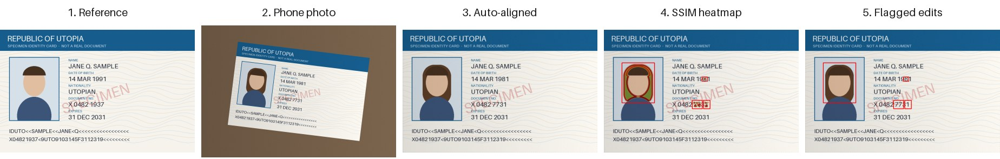
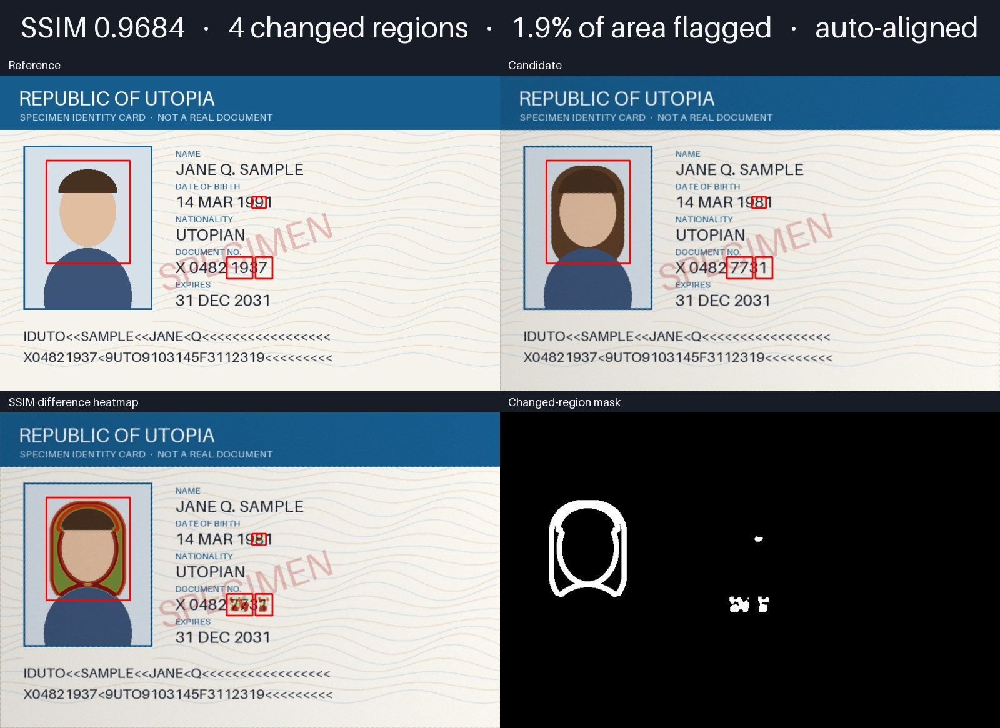
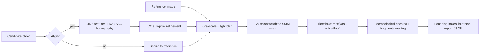

<h1 align="center">ID Card Tampering Detection</h1>

<p align="center">
  <b>Find edited fields in photos of ID cards and documents: altered dates, swapped portraits, changed numbers.</b><br>
  Explainable document forgery detection in Python with OpenCV feature alignment and SSIM (structural similarity).
</p>

<p align="center">
  <a href="https://github.com/saineshnakra/Identification-Card-Fraud-Detection/actions/workflows/ci.yml"></a>
  
  <a href="LICENSE"></a>
  <a href="https://colab.research.google.com/github/saineshnakra/Identification-Card-Fraud-Detection/blob/main/notebooks/quickstart.ipynb"></a>
  <a href="https://github.com/astral-sh/ruff"></a>
</p>

<p align="center">
  
</p>

`id-tamper-check` compares a **trusted reference image** of a document with a **candidate image**, for example a
phone photo taken at an angle. It aligns the two automatically, computes a per-pixel structural similarity map, and draws
boxes around the regions that were changed. Everything runs locally: no API keys, no uploads, no GPU.

```bash
pip install git+https://github.com/saineshnakra/Identification-Card-Fraud-Detection.git
id-tamper-check --demo        # runs on a built-in synthetic card, writes comparison/report.png
```

> [!IMPORTANT]
> This is an **explainable image-difference tool**, not an identity-verification or KYC system. An SSIM score is not a
> fraud probability. See [responsible use](#limitations-and-responsible-use).

## Contents

- [Features](#features)
- [Quick start](#quick-start)
- [Example output](#example-output)
- [Command-line reference](#command-line-reference)
- [Python API](#python-api)
- [How it works](#how-it-works)
- [Benchmark](#benchmark)
- [Use cases](#use-cases)
- [Limitations and responsible use](#limitations-and-responsible-use)
- [FAQ](#faq)
- [Roadmap](#roadmap) · [Contributing](#contributing) · [Citation](#citation)

## Features

- **Works on phone photos.** `--align` registers a rotated, scaled or perspective-distorted capture onto the reference
  with ORB features + RANSAC, then refines it to sub-pixel accuracy with ECC.
- **Low false-positive rate.** Gaussian-weighted SSIM, a noise floor on top of Otsu's threshold, and morphological
  cleanup keep genuine captures clean (0 false positives in the [benchmark](#benchmark)).
- **Field-level localization.** Character fragments are merged, so an edited date or number becomes one box.
- **Explainable output.** Annotated images, an SSIM heatmap, a binary mask and a one-page `report.png`.
- **Automation-friendly.** `--json` output and `--fail-under` exit codes for scripts, batch jobs and CI.
- **Try it without data.** A built-in generator draws clearly fictional *specimen* ID cards with realistic edits.
- **Many ways to run it:** CLI, Python library, Docker, Jupyter/Colab, or a Gradio web app.

## Quick start

### Install

```bash
pip install git+https://github.com/saineshnakra/Identification-Card-Fraud-Detection.git
```

Python 3.10 or newer. Dependencies: NumPy, OpenCV (headless), Pillow, scikit-image.

### Run

```bash
# 1. Zero-input demo: synthetic card, tampered and photographed at an angle
id-tamper-check --demo

# 2. Two scans or exports that are already framed the same way
id-tamper-check reference.png candidate.png

# 3. A phone photo: align first, print JSON, exit 1 if the score is below 0.98
id-tamper-check reference.png photo.jpg --align --json --fail-under 0.98
```

Sample images live in [`examples/`](examples/), so after cloning you can run:

```bash
id-tamper-check examples/specimen_reference.png examples/specimen_tampered_photo.jpg --align
```

### Other ways to run

| Option | How |
| --- | --- |
| **Google Colab** | [Open the quickstart notebook](https://colab.research.google.com/github/saineshnakra/Identification-Card-Fraud-Detection/blob/main/notebooks/quickstart.ipynb) |
| **Web app** | `pip install "id-tamper-check[web] @ git+https://github.com/saineshnakra/Identification-Card-Fraud-Detection.git"` then `python demo/app.py` ([deploy to Hugging Face Spaces](demo/README.md)) |
| **Docker** | `docker build -t id-tamper-check .` then `docker run --rm -u "$(id -u):$(id -g)" -v "$PWD:/data" id-tamper-check reference.png photo.jpg --align` |
| **Python module** | `python -m id_tamper_check --help` |

## Example output

Every run writes these files to `--output-dir` (default `comparison/`):

| File | Contents |
| --- | --- |
| `report.png` | 2×2 summary sheet with the score in the header (below) |
| `reference_annotated.png`, `candidate_annotated.png` | Inputs with red boxes around changed regions |
| `heatmap.png` | SSIM dissimilarity heatmap blended over the candidate |
| `difference.png`, `threshold.png` | Raw difference map and the binary changed-region mask |

<p align="center">
  
</p>

`--json` prints the same result in machine-readable form:

```json
{
  "score": 0.968448,
  "aligned": true,
  "changed_area_ratio": 0.019455,
  "image_size": { "width": 856, "height": 540 },
  "regions": [
    { "x": 79, "y": 145, "width": 143, "height": 176, "area": 25168, "mean_difference": 0.3357 },
    { "x": 388, "y": 310, "width": 44, "height": 37, "area": 1628, "mean_difference": 0.391786 }
  ],
  "output_dir": "comparison"
}
```

## Command-line reference

| Option | Default | Description |
| --- | --- | --- |
| `reference candidate` | | Paths to the trusted reference and the image to check |
| `--demo` | | Run on the built-in synthetic specimen instead of files |
| `--align` | off | Register the candidate onto the reference first (photos, scans with margins) |
| `--output-dir DIR` | `comparison` | Where to write the images |
| `--min-difference X` | `0.5` | Only flag pixels whose local `1 - SSIM` exceeds `X`; lower is more sensitive |
| `--min-region-area-ratio R` | `0.0005` | Ignore regions smaller than this fraction of the image |
| `--json` | off | Print a JSON summary instead of text |
| `--fail-under SCORE` | | Exit with status `1` when the SSIM score is below `SCORE` |
| `--version` | | Print the version |

Exit codes: `0` success, `1` score below `--fail-under`, `2` invalid input or alignment failure.

## Python API

```python
from pathlib import Path

from id_tamper_check import compare_documents, compare_images, render_report, save_result

# From files
result = compare_documents(Path("reference.png"), Path("photo.jpg"), align=True)
print(result.score, result.regions[0], result.changed_area_ratio)
save_result(result, Path("comparison"))

# From NumPy arrays (RGB, RGBA or grayscale uint8), e.g. frames from a camera or a web upload
result = compare_images(reference_array, candidate_array, align=True, min_difference=0.4)
report = render_report(result)  # RGB array, ready for PIL, matplotlib or Gradio
summary = result.to_dict()  # JSON-serializable
```

Synthetic test data:

```python
from id_tamper_check.samples import specimen_pair

reference, tampered_photo = specimen_pair(capture=True)
```

## How it works



1. **Load** both images (EXIF orientation applied) and convert to RGB.
2. **Align** (optional): detect ORB keypoints, match them with Lowe's ratio test, fit a RANSAC homography, then polish it
   with ECC so printed lines overlap to within a fraction of a pixel. Pixels outside the warped photo are ignored.
3. **Compare**: compute the Gaussian-weighted SSIM of Wang et al. (2004) on lightly blurred grayscale images. The
   per-pixel dissimilarity `1 - SSIM` becomes the difference map.
4. **Threshold**: a pixel is flagged only if it exceeds both Otsu's adaptive threshold and an absolute noise floor
   (`--min-difference`). Without the floor, Otsu splits pure camera noise into fake "changes" on genuine documents.
5. **Clean up**: a 3×3 opening drops thin edge slivers, and dilation merges the characters of an edited field into one
   region. Tiny regions are discarded.
6. **Report**: boxes, heatmap, mask, summary sheet and JSON.

## Benchmark

`scripts/benchmark.py` renders specimen cards, edits one or two fields at random (name, date of birth, document number,
expiry, portrait), simulates a handheld photo (rotation within ±20°, perspective, uneven lighting, sensor noise), and
compares each against the clean reference, alongside an equal number of unedited photos.

| Metric (100 genuine + 100 tampered photos) | Result |
| --- | --- |
| Tampered cards flagged | **95%** |
| Edited fields correctly localized | **92%** (135/147) |
| Genuine cards wrongly flagged | **0%** |
| SSIM, genuine photos | 0.9912 ± 0.0003 |
| SSIM, tampered photos | 0.9847 ± 0.0084 |
| Time per comparison (CPU, with alignment) | ~0.5 s |

The misses are near-invisible edits, such as changing a `Q` to an `O`, which alter only a few pixels. Reproduce with
`python scripts/benchmark.py --trials 100`. Synthetic data is cleaner than real-world captures, so treat these numbers
as a regression baseline, not a real-world accuracy claim.

## Use cases

- **Learning computer vision and image forensics:** a compact, readable, tested example of feature matching,
  homographies, SSIM, thresholding and contour analysis.
- **Document template QA:** catch unintended differences between a document template and a printed or exported version.
- **Prototyping KYC and onboarding checks:** an explainable baseline to compare against, and to show reviewers *where*
  two documents differ.
- **Before/after image comparison:** any pair of aligned images of the same flat layout (forms, certificates,
  labels, screenshots).

## Limitations and responsible use

- The reference and the candidate must show the **same document layout**. The tool finds differences; it does not know
  what a legitimate document of a given type looks like.
- Alignment corrects geometry, not **glare, blur, heavy compression, folds or lighting**. These lower the score and can
  create false regions.
- A **low score is not proof of fraud**, and a **high score does not prove a document is genuine**. A skilled forgery of
  a different person's card is a different document, not an edit of the reference.
- The method does not read text (OCR), validate MRZ checksums, barcodes or chips, compare faces, or check issuer
  records. Real identity verification needs those, plus liveness and human review.
- **Never commit or upload real identity documents.** Use the synthetic generator or licensed specimens. See
  [SECURITY.md](SECURITY.md).

## FAQ

<details>
<summary><b>Can SSIM detect a fake ID card?</b></summary>

SSIM detects <i>differences from a reference</i>. If you have a trusted image of the same document (for example the
version on file, or a template) it shows exactly which areas changed. It cannot judge a document it has no reference for.
</details>

<details>
<summary><b>What SSIM score means a document was tampered with?</b></summary>

There is no universal cut-off; it depends on the capture conditions. In the benchmark, genuine phone photos score about
0.991 and tampered ones about 0.985 on average, so look at the <b>regions</b> as well as the score. Calibrate
<code>--fail-under</code> on your own genuine samples.
</details>

<details>
<summary><b>Does it work with photos taken on a phone?</b></summary>

Yes. Use <code>--align</code>. It handles rotation, scale, translation and perspective for flat documents. EXIF
orientation is applied automatically.
</details>

<details>
<summary><b>Are my images uploaded anywhere?</b></summary>

No. The CLI, library, notebook and Docker image process files locally. Only a web demo you deploy yourself (for example
on Hugging Face Spaces) runs on that server.
</details>

<details>
<summary><b>How is this different from deep-learning document fraud detection?</b></summary>

Deep-learning detectors learn what forgeries look like from large labeled datasets and output a score. This tool needs
no training data, is fully explainable (every flagged pixel can be traced to the SSIM map), and runs in about half a
second on a CPU, but it requires a reference image. The two approaches are complementary.
</details>

## Roadmap

Ideas where contributions are welcome:

- [ ] Batch mode: compare one reference against a folder of candidates, with a CSV/HTML summary
- [ ] Glare and specular-highlight masking
- [ ] Optional OCR of flagged regions to report *which field* changed
- [ ] Automatic document detection and cropping from cluttered backgrounds
- [ ] Color-aware SSIM for edits that keep luminance but change hue
- [ ] Publish to PyPI and a hosted Hugging Face Space

## Contributing

Contributions are welcome! See [CONTRIBUTING.md](CONTRIBUTING.md) for setup, checks and guidelines.

```bash
python -m pip install -e ".[dev]"
ruff check . && ruff format --check . && pytest
```

## Citation

If this project helps your research or teaching, please cite it. GitHub's **Cite this repository** button uses
[CITATION.cff](CITATION.cff).

## Background

The project started in 2023 as a Google Colab tutorial, explained in the Medium article
[Fake ID card detection system using computer vision](https://saineshnakra.medium.com/fake-id-card-detection-system-using-computer-vision-af3feea226fe),
and has since grown into a tested, packaged tool. See the [changelog](CHANGELOG.md).

## License

[MIT](LICENSE) © [Sainesh Nakra](https://sainesh.com/)

<p align="center">
  If this project is useful to you, please consider giving it a ⭐. It helps others find it.
</p>

[](https://star-history.com/#saineshnakra/Identification-Card-Fraud-Detection&Date)
